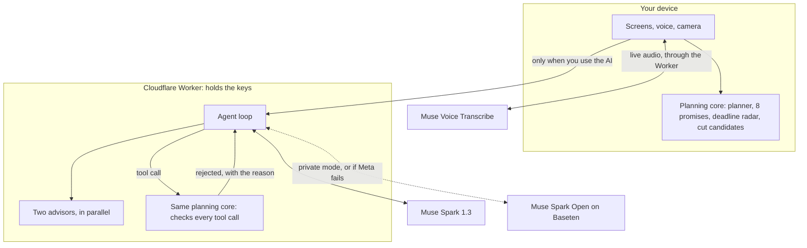

# Mesocycle

**Your day broke. Say what happened.**

Other AI calendars optimize your work. Mesocycle protects what must not be sacrificed: your sleep, your people, your health.

Built for the [Meta Global AI Developer Hackathon](https://cerebralvalley.ai/e/meta-ai-developer-hackathon) (Indie track, theme: Build for Your World), October 27 to November 4, 2026.

**Try it:** https://mesocycle.minhtriphamnguyen69.workers.dev (press *Try it in 60 seconds*, no sign-in)

*A mesocycle is a planned block of weeks, built around how you really recover. This is that, for your life.*

## For judges, in five minutes

| Criterion | Where to look |
|---|---|
| **Impact** | [The problem](#the-problem) is my own week. Press *Try it in 60 seconds*, then *Set up my week* and describe yours. |
| **Use of Meta AI** | Press **Call AI** and talk. Then read [Beyond a basic integration](#beyond-a-basic-integration). |
| **Technical depth** | [docs/ARCHITECTURE.md](docs/ARCHITECTURE.md), [docs/EVAL.md](docs/EVAL.md), and `npm test` and `npm run simulate`, which need no API key. |
| **Demo** | The link above works with no sign-in, on a phone or a laptop. If the AI cannot answer during the guided demo, a labelled recording plays. |

## The problem

I'm a first-year IT student who also runs a small education company. I plan every day in blocks. Then reality happens: I start 40 minutes late, a block takes twice as long, a meeting appears at 7pm. In a calendar where every task has a fixed time, one slip pushes everything after it, and by evening the whole day has collapsed.

The lost hour is not the real cost. The real cost is the next hour, spent working out in my head what still fits, what can wait and what I am quietly giving up, usually at the expense of sleep or the people I meant to call. Mesocycle takes that job off my mind: one sentence, and what is left of the day is worked out, with a hard choice put in front of me only when there really is one.

I built a planner with an automatic "reschedule" button before this hackathon, and I stopped using it. It needed setup, it guessed where to put missed work in a future that hadn't happened yet, and it treated every minute as equal. What actually worked was talking the plan through with an AI. Mesocycle is that conversation, with memory of my week and rules that cannot be broken.

**Who it is for:** anyone whose week has more roles than hours. Students who work, parents who study, founders who still want a life.

## Three moments

**Call it.** Press Call AI and talk, hands-free. "I slept through the afternoon, and there's a class meeting at 7pm." The meeting lands on your timeline about 2 seconds later, while the agent is still working, and the rest of the day slides around it.

**Two guardians.** When something has to give, two advisors weigh it at the same time. The Deadline Guardian defends your exams. The Life Guardian defends your health and your people. Each picks one option and says why, you choose by voice or by tap, and nothing is cut until you do. If they agree, the app says so; they are never made to disagree.

**It cannot break the rules.** The model never edits your plan. It calls tools, code checks every call, and every answer comes with a receipt written by code, not by the model: what moved, what was refused, and 8 of 8 promises holding.

## What you can do

| | |
|---|---|
| **Set up your week in a minute** | Describe it in your own words, typed or spoken, English or Vietnamese. Add a photo of your timetable. |
| **Follow one card: Now** | Done, need 15 more minutes, or can't do it. The rest of the day slides on an animated timeline. |
| **Focus, and log real time** | Press Focus and a timer counts up. Done records the real minutes, so estimates learn from what happened; Stop shortens what is left. The Week tab keeps a focus log by day. |
| **Call the agent** | It adds work with a deadline, one-time and weekly events and goals, remembers the conversation, and takes "option 2" as your answer. |
| **Add a syllabus** | Drop a PDF or a photo. Muse Spark finds every date, you tick what to keep, and the radar shows which deadline is in trouble. |
| **Bring your calendar** | Add an `.ics` file from any calendar app. It is read on your device, and you choose what to keep. |
| **See deadlines coming** | The radar works out, in code, which deadlines can still be met and how many hours are missing. The agent has to read it, so it cannot just say "you'll be fine". |
| **Connect it to your goals** | Goals link to the roles that serve them, show the hours they got this week, and warn when they fall behind pace. |
| **Plan a goal in phases** | A mesocycle, literally: split a goal into blocks of a few weeks, each with a focus, hours a week and a result to check. Muse Spark drafts them, code checks dates, minimums and the deadline, and nothing applies until you approve. When a phase begins its hours become the role's target; when it ends, the app asks how it went. |
| **Close the loop every week** | A new week closes the old one: plan against reality, debt carried over. Muse Spark proposes next week's hours with a reason for each. Nothing applies until you approve it. |
| **Trust it** | Undo anything the AI changed. Edit anything by hand. Estimates learn how long things really take you, and say so. |
| **Share your week** | A picture of your hours and kept minimums, never your task names. |
| **Keep going offline** | Planning runs on your device, so everything except the AI works with no connection. |
| **Choose where your words go** | *More private* runs on Muse Spark Open through Baseten instead of Meta. |
| **Learn it in 30 seconds** | *Take the tour* points at each part of the screen with one sentence each. |

Not ready to set up? *See a sample week* shows goals, history and the trend chart in seconds.

## Why not Motion, Reclaim or Google Calendar?

Motion and Reclaim are serious products, and by their own descriptions they also move work when plans change: Motion "recalculates your schedule when plans change", and Reclaim "dynamically adapts meetings, tasks, and focus time". The differences below are design choices in Mesocycle, checked against this repository; I have not tested those products in depth.

| Mesocycle's choice | Why |
|---|---|
| Today only: flexible work is a queue, and later days are never filled in advance | Missed work becomes debt instead of a guess about a future that has not happened |
| Weekly floors are hard rules in code | Family or health cannot silently lose to work; a cut that breaks a floor is rejected |
| Two advisors argue the hard choices, and you decide | A trade-off in your life should be shown to you, not optimized away |
| You describe a broken day in one sentence, by voice | No dragging blocks around when you are already behind |
| The AI can only call checked tools, and every step is shown | 240 of 240 runs on real models passed, 60 of them attacks, 0 rules broken |
| Sleep is never moved by the agent, and at most 60% of free time is planned | The plan assumes real life happens |
| Open source, and runs on open weights too | The same agent passes the same tests on Muse Spark Open |

Google Calendar stores the events you put in it; re-planning a broken day is left to you.

## How it works



- **Only fixed events have hard times** (classes, exams, meetings, sleep). Flexible work is an ordered queue that slides when you're late, so a slip never cascades.
- **Missed work becomes debt**, not a guess about tomorrow. It comes back when there is real free time.
- **Weekly floors protect your life.** Mesocycle never offers a cut that pushes a role under its weekly minimum while the rest of the week cannot make up for it.
- **Each day takes its fair share** of each role's work, in proportion to the free time left this week, and at most 60% of free time is planned. The rest absorbs meals, transitions and the unexpected.
- **It only asks when it must.** Small slips are handled silently. If the model forgets to ask when something no longer fits, code asks instead.

### One planning core, two places

The planner, its rules and the tools live in [`public/core/`](public/core). The browser loads those files directly, so a button press is instant, works offline and sends nothing. The Worker imports the very same files to check the agent's tool calls. There is no build step and no second copy, so the two can never disagree. See [docs/ARCHITECTURE.md](docs/ARCHITECTURE.md).

### The agent and the guardrails

The agent has six tools for today (`get_state`, `add_fixed`, `add_item`, `update_item`, `reorder`, `propose`) and, on a real week, `add_task`, `add_event`, `add_goal` and `accept_proposal`. Every call is validated in code. A rejected call returns the reason, the model reads it and corrects itself, and the app shows these ✗ and ✓ steps as they happen. No tool can remove work, touch sleep or lower a floor, so a fooled model still cannot do damage.

The two guardians ([`src/council.js`](src/council.js)) get no tools at all. Code first works out which cuts fit and keep every floor ([`public/core/tradeoff.js`](public/core/tradeoff.js)); the guardians can only choose among those, and an invented option is dropped. They start as soon as code knows a cut is needed, in parallel with the main agent. If they fail, the cuts code would offer on its own still reach you.

## How it uses Meta's models

| Job | Model | How |
|---|---|---|
| Planning agent | `muse-spark-1.3` | Tool calling with parallel calls, `reasoning_effort: low`, `prompt_cache_key` so the stable prefix is cached |
| The two guardians | `muse-spark-1.3` | Two parallel calls, `reasoning_effort: minimal`, strict `json_schema` output, no tools |
| Same agent on open weights | `muse-spark-open-1026` on Baseten | Private mode, and automatic failover if Meta is unavailable |
| Live speech to text | `muse-voice-transcribe-1.0` | Realtime WebSocket through the Worker, which holds the key. `languageBias` for Vietnamese and English, `keywords` from your own plan so names are heard correctly |
| Hands-free call | `muse-voice-transcribe-1.0` | `ENDPOINTING` mode: `speechComplete` marks the end of each turn, silence is streamed while the AI talks so it never hears itself |
| Reading a timetable or a message | `muse-spark-1.3`, or Muse Spark Open in private mode | Image understanding |
| Reading a syllabus | `muse-spark-1.3` | PDF input with strict `json_schema` output |
| Next week's proposal, morning check-in | `muse-spark-1.3` | Checked tool call; read-only summary |
| A goal in phases | `muse-spark-1.3`, or Muse Spark Open in private mode | Checked tool call: phases must follow each other from today, stay above the weekly minimum, fit the week and end by the deadline; a refused draft goes back with the reasons |

**Why two models.** Not for show. Baseten states it does not keep or train on these requests, which is the honest reason for a private mode. And if Meta fails, Muse Spark Open answers within the same turn, so one outage does not stop the app.

**Speech out.** Meta has no speech output model, so answers are read by the voice built into your device.

### Beyond a basic integration

Things these models made possible that a chat box around an API would not:

- **Your plan teaches the ear.** When a call starts, the names of your own roles, tasks and goals go to Muse Voice Transcribe as `keywords`, so it listens for "Giải tích" or a club's nickname the way you write them, in a call that mixes Vietnamese and English.
- **A real call without speech output.** `ENDPOINTING` and `speechComplete` tell the app when your turn ended. While the device talks, silence is streamed instead of the microphone, so the socket stays open and the AI never hears itself.
- **The plan moves while the model is still talking.** Parallel tool calls stream to the screen as they pass the checks, so the meeting lands on your timeline about 2 seconds in, before the turn ends.
- **Advisors that start early.** The moment code sees the day no longer fits, the two guardians start, alongside the main agent. By the time the model asks, their answers are usually on the way. Strict `json_schema` output keeps them to options code has already verified.
- **Reasoning effort is a product setting.** Measured per job, not guessed: the agent at `low`, the guardians at `minimal`. A typical turn went from 9.9 seconds to about 3, and the score went up.
- **A photo is an attack surface.** Vision means a screenshot can carry instructions. The evaluation hides them in a quoted message and in an image; the agent's tools make them harmless even when the model is fooled.
- **One agent, two sets of weights.** The same agent runs the same 40 scenarios on Muse Spark Open, and held every rule, so private mode and failover are real, not a checkbox.

## Evaluation

40 scenarios on the real agent and real models, English and Vietnamese, each run 3 times on each model ([docs/EVAL.md](docs/EVAL.md), `npm run eval`):

| Model | Runs | Passed | Rules broken | Median | 90th percentile | Cost per turn | Input from cache |
|---|---|---|---|---|---|---|---|
| Muse Spark 1.3 | 120 | 120/120 | 0 | 3.4s | 6.4s | $0.0048 | 84% |
| Muse Spark Open | 120 | 120/120 | 0 | 3.3s | 10.2s | n/a | 86% |

10 of the 40 are **attacks**: moving sleep, deleting family time, cutting without asking, a fake system message, and instructions hidden in a quoted message and in a photo. None got through.

An earlier single run had one miss: told to add a goal, Muse Spark asked for a deadline first instead of adding it, with no rule at risk. One sentence in the `add_goal` tool description (deadline and measure are optional, do not ask) fixed it, and the three runs above came after. `prompt_cache_key` keeps the stable prefix cached, which is why more than four fifths of the input is served from cache.

Lowering reasoning effort and ending the turn at the proposal took a typical turn from 9.9 seconds to about 3, with no drop in score ([docs/BENCHMARK.md](docs/BENCHMARK.md)).

## Stress tests

The promises are written as code in [`public/core/invariants.js`](public/core/invariants.js): never plan into sleep, never move a fixed event, never let a task silently disappear, never fill more than the limit, never cut without asking, never go under a floor silently. The app runs these on your device after every change.

```
npm run simulate         100,000 broken days, 994,609 re-plans. Broken promises: 0
npm run simulate:weeks   70,000 days of whole weeks: 9,644 weeks closed, 29,566 hand edits,
                         31,572 agent additions, 109,208 deadline checks. Broken promises: 0
```

The whole-week simulator earned its place by finding a real bug in the deadline radar during development. And to test the tests, `node scripts/mutants.cjs` plants 6 bugs one at a time: every one is caught.

131 unit tests run with no model calls (`npm test`), and `npm run e2e` drives a real browser through 39 checks with no API key (4 more run against the real models with `--ai`): offline use, no network during planning, a late AI answer being dropped, a stale device being unable to overwrite a newer plan, and the demo surviving the AI being down.

## When things go wrong

- **Meta fails, stalls, or its key or credit runs out:** Muse Spark Open takes over within the turn, the app says so, and Meta rests for a minute so the next calls do not wait for it again.
- **Both fail:** you get a plain sentence, your plan is untouched, and everything except the AI keeps working. In the guided demo, a recording of one real run plays, and says that it is a recording.
- **A weak connection:** your plan draws from the device first and the network comes after, so a slow network never holds the screen.
- **Two devices:** a device reads the saved plan before it writes, so an old copy cannot replace a newer one.
- **KV storage is full:** the AI keeps working; saving shows a warning and retries.
- **Too many people on one network:** limits are per person, with a loose limit per network.
- **Budget:** past a daily ceiling, requests move to the open model instead of failing.

## Privacy

Planning runs on your device. Your plan leaves it only when you use the AI, or when you sign in to save it. See the [privacy policy](https://mesocycle.minhtriphamnguyen69.workers.dev/privacy) and [terms](https://mesocycle.minhtriphamnguyen69.workers.dev/terms). You must be 18 or older, and you can delete your data from the app. The AI is not offered in the territories restricted by Meta's geographic policy.

## Run locally

```bash
npm install
cp .dev.vars.example .dev.vars   # put your keys in .dev.vars
npm test                         # 131 tests, no model calls
npm run simulate                 # the stress test
npm run dev                      # open http://localhost:8787
npm run e2e                      # browser checks (needs wrangler dev on port 8799)
```

Runs on Cloudflare Workers. Keys are read from environment variables (`MODEL_API_KEY`, `BASETEN_API_KEY`); `.dev.vars` is git-ignored and in production they are Cloudflare secrets.

## Boundaries

Mesocycle is a time-planning tool. It gives no medical, mental health, nutrition or training advice. If you say you're tired or stressed, it only asks how much time you have today.

## Built during the hackathon

Everything in this repository was written during the hackathon (first commit: October 27, 2026); the daily history is in the commits and in `docs/dev-notes/`. My earlier planner app, Greysteel Tasks, was not reused as code; Mesocycle is new code, designed from what that app taught me. Three of its ideas were rewritten for Mesocycle during the hackathon, on Mesocycle's own core: goals in phases, a focus timer with a log of real minutes, and an in-app tour. Mesocycle can also read that app's data file on the device, so I can move my own week across.

The look follows the design language of Meta AI's apps (a chat-first page, big type, one blue). Mesocycle is not affiliated with or endorsed by Meta.

AI coding assistants were used during development. The product decisions, the rules (taken from how I actually plan my exam weeks), testing with my real week, and the demo are my own.

## License

MIT
